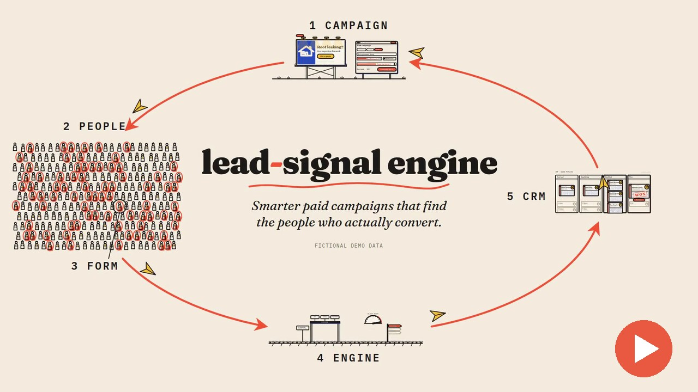
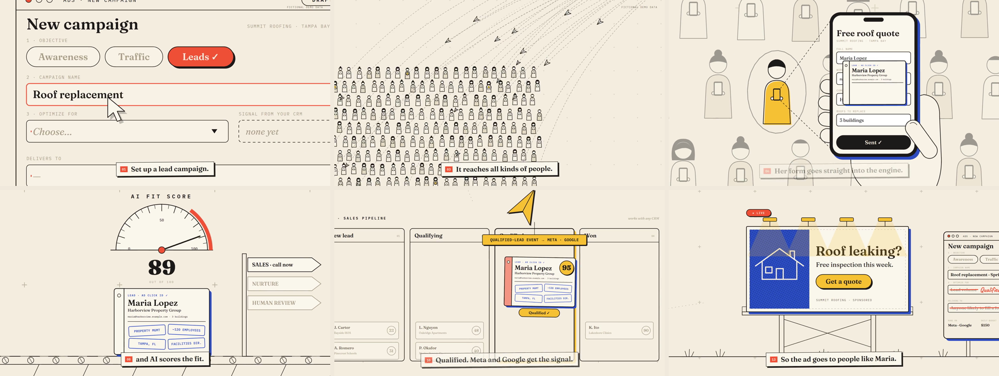
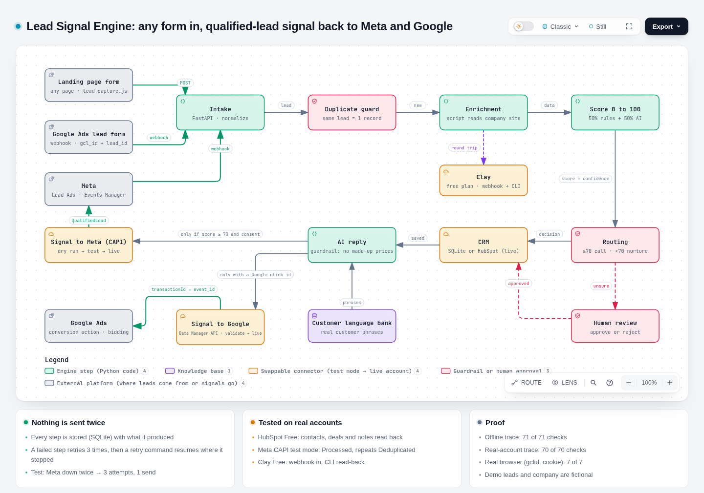

# Lead Signal Engine

*Smarter paid campaigns that find the people who actually convert.*

**Paid leads go from the form to the CRM in seconds, already enriched and scored. The qualified ones go back to Meta and Google, so the campaign learns who to find next.**

*73 seconds, no voice. Click the image to watch. All people, companies and data in the video are fictional.*

## 1. The problem

Most lead campaigns optimize for lead volume. The ad platform only knows that someone filled a form, not if that person was a good fit. So it keeps finding more people who fill forms, cheap leads that sales never closes. In the meantime the good leads wait hours in a spreadsheet before somebody calls.

## 2. What it does

1. **Captures** the lead from any landing page form, Meta Lead Ads or Google Ads lead forms. A one-line script keeps `gclid`, `gbraid`, `wbraid`, `fbclid` and UTMs for 90 days.
2. **Removes duplicates.** The same person twice gives one record and one message.
3. **Enriches** the company: website + AI, or Clay.
4. **Scores** the fit with rules and an AI rubric, and gives a confidence level.
5. **Routes** it: call now, nurture, or a person reviews it when confidence is low.
6. **Writes it to the CRM** (HubSpot, or any CRM) and sends a first reply grounded in the business's own words.
7. **Sends the qualified lead back to the ad platforms:** Meta through the Conversions API and Google Ads through the Data Manager API. Both use the same `event_id`, so nothing is counted twice.

Step 7 is what changes the campaign. The algorithm stops learning "who fills forms" and starts learning "who becomes a qualified lead". The CPL can go up, because the platform stops chasing the cheapest form fills. But the cost per qualified lead and the CPA go down, and those are the numbers that pay the bills.

## 3. Proof that it runs

| What | Result | Report |
|---|---|---|
| Full scenario offline, 9 leads, every hop checked | 71/71 checks pass | [proof/TRACE.md](proof/TRACE.md) |
| Same run against real accounts: HubSpot Free CRM + Meta Conversions API (test mode) | 70/70 checks pass. Contacts, deals and notes read back from HubSpot. `QualifiedLead` events show as *Processed* in Meta Events Manager | [proof/TRACE-live-accounts.md](proof/TRACE-live-accounts.md) |
| Clay on a real Free workspace | Webhook in, *Enrich company*, read back by CLI, 5/5 companies enriched | [proof/CLAY-CHECK.md](proof/CLAY-CHECK.md) |
| Capture script in a real browser | `gclid` from the URL and `gbraid` from an earlier visit both reach the engine, and the page form still submits | [proof/BROWSER-CHECK.md](proof/BROWSER-CHECK.md) |
| Automated tests | 58 pass: unit, adapters with mocked HTTP, end to end through the API | code walkthrough on a call |

Failure handling is part of the checks: a forced API failure is retried and sent once, an outage longer than the retry budget is parked and resumed later without repeating the steps that already worked.

## 4. Architecture

Design notes on the ad-platform signals: [docs/DESIGN-ad-signals.md](docs/DESIGN-ad-signals.md).

**Stack:** Python, FastAPI, SQLite ledger, Claude (structured output), HubSpot API, Clay, Meta Conversions API, Google Ads Data Manager API, plain JavaScript capture script.

## 5. Where this comes from

I built the first version of this system at SalesCheck, running paid lead generation for B2B clients. When the qualified-lead signal started going back to the ad platforms, the CPL went up, and the cost per qualified lead and the CPA went down.

This repository is the rebuilt version, made to plug into any landing page, any form and any CRM. All data in the demo and in the video is fictional.

## 6. The code

The repository with the code is private for now. I walk through it, and run it live, on a call.

**Ramon Nassaralla** · GTM / AI Automation · [LinkedIn](https://www.linkedin.com/in/ramon-nassaralla-322a54180)
